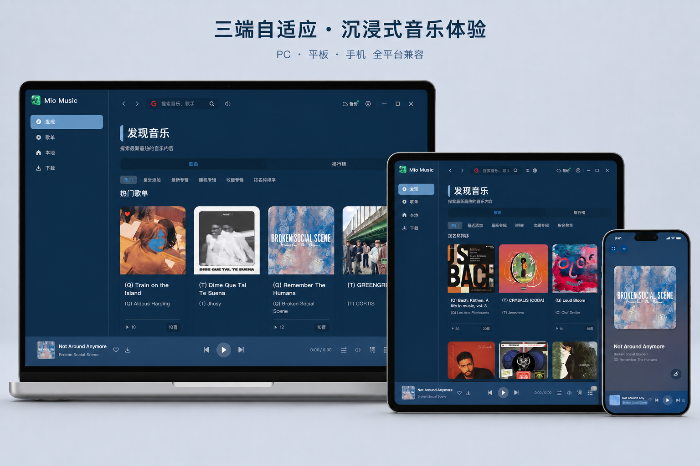

<p align="center">
  
</p>

<h1 align="center">Mio Music</h1>

<p align="center">一个播放器，听本地音乐、连接个人音乐服务器，用插件扩展在线来源。</p>

<p align="center">
  <a href="README.md">English</a> · <b>简体中文</b>
</p>

[开始使用](#开始使用) · [默认插件](#默认支持的插件) · [功能特性](#功能特性) · [客户端支持](#客户端支持) · [开发](#开发) · [文档](https://mio888888.github.io/Mio-Music/)

---

## 简介

**Mio Music 是一个本地优先、支持插件扩展的跨平台音乐播放器。** 你可以用它播放本地音乐，连接已有的个人音乐服务器，也可以通过兼容插件接入其他在线来源。

- **本地音乐：** 扫描音乐文件，管理标签、封面、收藏与歌单，不需要配置在线插件。
- **个人曲库：** 内置 Songloft、Subsonic、Navidrome、Jellyfin、Emby、Plex 接入插件，在同一个播放器里搜索和播放服务器中的音乐。
- **听歌体验：** 逐字与 TTML 歌词、翻译与音译、动态背景、均衡器、无缝播放和交叉淡入淡出。
- **多端使用：** 桌面端覆盖 macOS、Windows、Linux；Flutter 客户端面向 Android 手机、平板、电视及 iPhone、iPad。各平台的验证状态见[客户端支持](#客户端支持)。

> **Mio Music 不是音乐内容服务，不自带公共曲库或音乐服务账号。** 本地播放无需服务器；使用内置插件时，需要你已有的服务器地址及相应账号或访问令牌。在线内容与可用权限由服务器和插件决定。

<p align="center">
  
</p>

## 开始使用

先查看[客户端支持](#客户端支持)与[发布情况](#发布情况)，确认安装包对应的平台和版本；体验当前源码可按[开发](#开发)章节运行。

| 你想做什么 | 从这里开始 |
|---|---|
| 播放本地音乐 | 打开本地音乐页面，导入或扫描音乐文件，无需安装在线插件 |
| 连接个人音乐服务器 | 在 **设置 → 插件 → 音乐列表插件** 中配置下表对应的内置插件 |
| 扩展其他在线来源 | 安装兼容的音乐列表插件；若该插件不提供播放地址，再配合支持同一来源的音源插件 |

详细操作见[使用指南](https://mio888888.github.io/Mio-Music/docs/user-guide.html)。

## 默认支持的插件

以下 **6 个音乐列表插件随应用内置，无需另外下载脚本**。它们都提供歌曲搜索、专辑与歌单浏览、发现、播放与下载地址解析；歌手、歌词等额外能力因插件而异。

| 默认插件 | 连接的服务与补充能力 | 连接配置 |
|---|---|---|
| **Songloft** | Songloft 个人音乐服务器；支持歌手、流派与歌词 | 服务器地址、用户名、密码 |
| **Subsonic** | Subsonic API 兼容的音乐服务器 | 服务器地址、用户名、密码 |
| **Navidrome** | Navidrome；相比通用 Subsonic 插件，另支持歌手页与歌词 | 服务器地址、用户名、密码 |
| **Jellyfin** | Jellyfin 音乐库；支持歌手页与歌词 | 服务器地址，以及用户名登录或访问密钥；密码按账号要求填写 |
| **Emby** | Emby 音乐库；支持歌手页 | 服务器地址，以及用户名登录或访问密钥；密码按账号要求填写 |
| **Plex** | Plex Media Server 音乐库；支持歌手页 | 服务器地址、`X-Plex-Token`；可选音乐库名称，留空使用第一个音乐库 |

### 配置内置插件

1. 打开 **设置 → 插件 → 音乐列表插件**，找到对应服务，点击 **配置**。
2. 按上表填写服务器地址与认证信息。非回环地址的 `http://` 服务器还需开启 **允许 HTTP（不加密）**；`localhost` 等回环地址无需开启。
3. 点击 **测试连接** 检查当前表单，再保存配置并确认插件已启用。
4. 在搜索或发现页面选择该来源，即可访问服务器曲库。内置插件默认自行提供播放与下载地址，**无需再安装音源插件**。

应用启动时会安装缺失的内置插件，并用应用携带的更高版本更新旧副本，保留已有配置与启用状态；不使用时可以停用，不能卸载。新安装且尚未配置的插件不会提供可选来源。

具体能力还受服务器版本与账号权限影响。脚本、配置说明及服务验证范围见 [mio-music-plugins](https://github.com/Mio888888/mio-music-plugins)。

### 还支持哪些插件？

| 插件类型 | 负责什么 | 支持方式 |
|---|---|---|
| **音乐列表插件** | 提供搜索、歌单、专辑、发现等内容，也可以自己解析播放与下载地址 | 除内置插件外，可从本地文件或 URL 安装兼容的列表脚本；可同时启用多个 |
| **音源插件** | 根据歌曲信息解析播放地址，不提供搜索与歌单 | 支持澜音（LanYin）脚本，洛雪（LuoXue / LX）脚本安装时自动转换；需显式选择当前使用的插件 |

插件运行在有资源限制的 QuickJS 沙箱中。开发自己的接入脚本可阅读[插件开发者指南](https://mio888888.github.io/Mio-Music/docs/plugins/)。

## 功能特性

### 音乐播放

- 基于 Rodio、cpal、Symphonia 的原生音频引擎，本地与在线歌曲通用
- 下一曲提前缓存，无缝播放与可配置淡入淡出；在线音频边下载边解码
- 10 段均衡器，内置预设并可导入 AutoEq，另有音效与声道平衡
- 实时 FFT 频谱
- 桌面端支持系统媒体键、托盘和全局快捷键；移动端支持锁屏与通知栏控制

### 歌词

- 逐字歌词与 TTML 歌词，Apple Music 风格渲染（AMLL）
- 翻译、音译、背景人声与对唱
- macOS 桌面歌词窗口；自定义歌词字体

### 界面

- 封面取色动态主题，品牌色与错误色保持 4.5:1 对比度，按钮与文字始终清晰
- 随音频律动的动态背景
- 浅色与深色模式；中文与英文

### 音乐库与数据

- 本地音乐扫描、标签与封面、标签编辑、收藏与歌单
- 下载支持暂停/继续、重试、速度显示与标签写入
- 兼容 S3 的备份与恢复（AES-GCM 加密），可部分导入旧版应用数据
- DLNA 投放、听歌识曲、签名自动更新
- 本地优先：音乐库与设置保存在本地 SQLite，不依赖任何云服务

## 客户端支持

| 平台 | 安装包 | 状态 |
|---|---|---|
| macOS（Apple 芯片） | `.dmg`，更新用 `.app.tar.gz` | **基准平台。** 播放、歌词、下载、备份与主要页面已在原生应用中验证 |
| Windows x64 | NSIS `-setup.exe` | CI 中完成构建、类型检查与单元测试；尚未在设备上运行 |
| Linux x86_64 | `.AppImage`、`.deb` | CI 中完成构建、类型检查与单元测试（Ubuntu 24.04，需 glibc 2.39+）；尚未在设备上运行 |
| Android 手机 / 平板 / 电视（arm64-v8a、armeabi-v7a） | `.apk` | 已在 API 36 手机、平板、电视模拟器上做验收；真机与 armv7 运行待验证 |
| iPhone / iPad | 未签名 `.ipa` | 可在 iOS 模拟器中运行；代码签名与真机待验证 |
| 鸿蒙 | — | 实验性，不在 `main`：可构建未签名的调试 `.hap`；尚未在设备上运行 |

不提供 Intel 版 macOS 与 x86_64 Android 包。macOS 包为临时签名，未经公证。

## 发布情况

安装包由 `Build` 工作流发布到 [GitHub Releases](https://github.com/Mio888888/Mio-Music/releases)：只要 `Cargo.toml` 的版本号还没有对应的 `v<版本>` tag，就会编译全部平台、上传安装包与 `latest.json`，然后发布。

- **当前状态：** 重写版尚未发布正式版本。GitHub Releases 上仍是旧 Tauri 版的 `v0.3.x`，其用户继续从那里获取更新。
- **更新内容：** 每次发布都附带自上个版本以来的改动，由提交信息生成，两端都会在更新对话框中显示。
- **自动更新：** 桌面端读取 `latest.json` 并校验 Ed25519 签名；格式与 Tauri 版一致，已安装的旧版可以直接覆盖更新。

发布流程见 [`.github/workflows/build.yml`](.github/workflows/build.yml)。

## 技术栈

本仓库是 [Tauri 版 Mio Music](https://github.com/Mio888888/Mio-Music/releases/tag/v0.3.6) 的原生重写版，后者基于 [CeruMusic](https://github.com/timeshiftsauce/CeruMusic) 重构。桌面端使用 Rust 与 [GPUI Kit](https://gpui-kit.com/)，Flutter 客户端与桌面端共用 Rust 核心（`mio-core`）。重写范围延续原版的功能、布局和数据格式，不包含 AI 助手。

| 层级 | 技术 |
|-------|-----------|
| 桌面端界面 | GPUI Kit 0.7.2（`gpui-fast`） |
| 移动端界面 | Flutter + flutter_rust_bridge 2.13 |
| 语言 | Rust（2024 版）、Dart |
| 音频引擎 | Rodio + cpal + Symphonia |
| 音频处理 | rustfft（频谱）；均衡器与音效在 `mio-core` 中实现 |
| 插件运行时 | QuickJS（rquickjs）沙箱 |
| 数据库 | SQLite（rusqlite） |
| 界面令牌与图标 | TDesign |
| CI | GitHub Actions |

## 开发

### 环境要求

- [Rust](https://www.rust-lang.org/tools/install) 稳定版，1.85 或更新
- Git，以及 [GPUI Kit 文档](https://gpui-kit.com/docs/) 列出的原生构建依赖（CI 实际安装的包见 [`.github/workflows/check.yml`](.github/workflows/check.yml)）
- 移动端还需要 Flutter、Android SDK/NDK 或 Xcode，见 [`apps/mobile/README.md`](apps/mobile/README.md)

### 安装与运行

内置插件是 Git 子模块（[mio-music-plugins](https://github.com/Mio888888/mio-music-plugins)），克隆时需要带上子模块：

```bash
git clone --recurse-submodules https://github.com/Mio888888/Mio-Music.git
cd Mio-Music
# 已经克隆过？git submodule update --init

# 运行桌面端
cargo run --locked -p mio-app

# 构建 macOS 开发包（target/debug/Mio Music GPUI.app）
sh tools/bundle-macos.sh
```

### 检查

```bash
cargo fmt --all -- --check
cargo test --workspace --locked
cargo check --workspace --locked
```

| 内容 | 环境 | 时机 |
|---|---|---|
| 整个工作区的 `cargo fmt --check`、`cargo check`、`cargo test` | macOS 15、Windows、Ubuntu 24.04（`Desktop checks`） | 每次推送到 `main` |
| 五个平台的发布构建 | `Build` 工作流 | 版本号还没有 tag 时，或手动以 `build_only` 运行 |
| 交互验收 | macOS 应用；Android 模拟器；iOS 模拟器 | 开发过程中人工进行 |

移动端的验收记录见 [`apps/mobile/README.md`](apps/mobile/README.md)。真机检查是单独的用例，默认的离线测试会跳过。

### 数据位置

| 平台 | 目录 |
|---|---|
| macOS | `~/Library/Application Support/Mio Music GPUI` |
| Windows | `%APPDATA%/Mio Music GPUI` |
| Linux | `$XDG_CONFIG_HOME/mio-music-gpui`（默认 `~/.config/mio-music-gpui`） |

测试时可设置 `MIO_GPUI_DATA_DIR` 使用独立目录。默认不读取 Tauri 版的数据，可在 **设置 → 存储 → 旧版应用数据** 中导入。

### 编写插件

[插件开发者指南](https://mio888888.github.io/Mio-Music/docs/plugins/) 介绍了两类插件、数据结构、沙箱运行时 API 与发布方式；[mio-music-plugins](https://github.com/Mio888888/mio-music-plugins) 里的脚本都是完整可用的范例。`tools/golden/subsonic_fixture.py` 是只监听本机的 Subsonic 测试服务，数据全部为合成数据，可以在没有真实服务器时试用插件。

## 项目结构

```
├── crates/
│   ├── mio-app/             # 桌面应用：GPUI 界面、托盘、快捷键、媒体键、桌面歌词、DLNA、更新器
│   ├── mio-core/            # 共用核心：播放与音效、音乐库（SQLite）、下载、备份、歌词、主题、插件
│   ├── mio-music-sdk/       # 音乐列表约定：provider trait、能力、数据类型、歌词/评论/封面解码
│   ├── mio-plugin/          # 插件宿主：QuickJS 沙箱、列表插件加载、LuoXue 转换
│   ├── mio-tokens/          # 界面令牌（浅色与深色调色板）
│   └── mio-mobile-bridge/   # 移动端使用的 flutter_rust_bridge API
├── apps/mobile/             # Android 与 iOS 的 Flutter 应用
├── plugins/                 # 内置列表插件（子模块）
├── tools/                   # 打包、CI 脚本、发布说明、截图比对工具、Subsonic 测试服务
└── website/                 # 静态网站与文档（GitHub Pages）
```

## 参与贡献

欢迎参与贡献。请先阅读 [CONTRIBUTING.zh-CN.md](CONTRIBUTING.zh-CN.md) 和[行为准则](CODE_OF_CONDUCT.zh-CN.md)；PR 与 issue 模板里列出了需要提供的内容。安全问题请按 [SECURITY.zh-CN.md](SECURITY.zh-CN.md) 私下报告。

## 致谢

- [CeruMusic](https://github.com/timeshiftsauce/CeruMusic) — 原始项目，作者 **ShiQianJiang**
- [Mio Music（Tauri 版）](https://github.com/Mio888888/Mio-Music/releases/tag/v0.3.6) — 本项目复刻的应用
- [GPUI Kit](https://gpui-kit.com/) — 原生桌面界面框架
- [Flutter](https://flutter.dev/) 与 [flutter_rust_bridge](https://github.com/fzyzcjy/flutter_rust_bridge) — 移动端应用及其 Rust 桥接
- [TDesign](https://tdesign.tencent.com/) — 设计令牌与图标
- [Apple Music-like Lyrics](https://github.com/Steve-xmh/applemusic-like-lyrics) — 歌词与背景样式
- [AutoEq](https://github.com/jaakkopasanen/AutoEq) — 均衡器预设数据

## 支持当前作者

Mio Music 的持续维护、跨平台适配与问题修复由当前项目作者完成。如果这个项目对你有帮助，可以通过下方的赞赏码支持后续开发。

<p align="center">
  
</p>

> 所有赞赏均为自愿，将直接用于当前作者的持续开发与维护。

## 免责声明

Mio Music 提供音乐播放、管理与插件运行能力，不提供或托管公共曲库。在线播放与下载通过用户配置的插件访问第三方服务或个人服务器。你需要自行确保有权访问、播放和下载相关内容，并遵守所在地区的法律与服务条款，尊重第三方的权益。

## 许可证

Mio Music 是自由软件，采用 [GNU Affero 通用公共许可证 v3.0](LICENSE)（`AGPL-3.0-only`）授权。你可以使用、研究、修改和分享它，包括商业使用；前提是基于它的衍生作品也要以相同许可证连同源代码一起发布，用户通过网络与之交互时同样适用。

本项目经由 Tauri 版 Mio Music 衍生自 [CeruMusic](https://github.com/timeshiftsauce/CeruMusic)（版权所有 © 2026 时迁酱，`AGPL-3.0-only`）。第三方代码保留各自的许可证：`vendor/` 与 `apps/mobile/vendor/` 下的内置库为 Apache-2.0 或 MIT，其余依赖见 `Cargo.lock` 与 `apps/mobile/pubspec.lock`。贡献按相同许可证接受，见 [CONTRIBUTING.zh-CN.md](CONTRIBUTING.zh-CN.md)。
